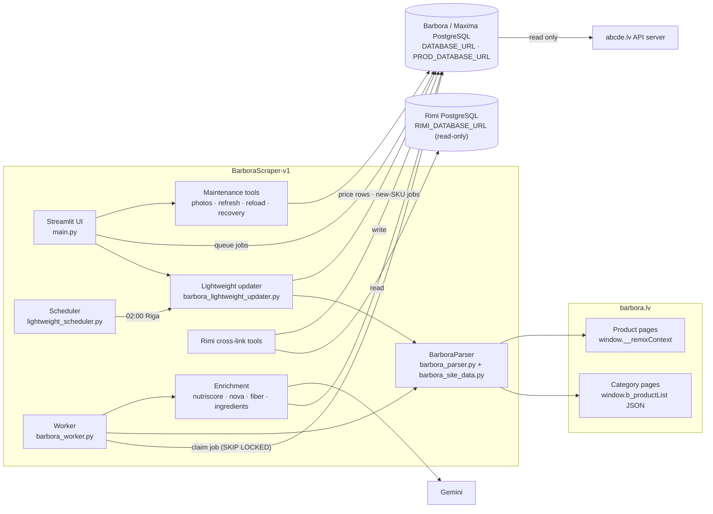
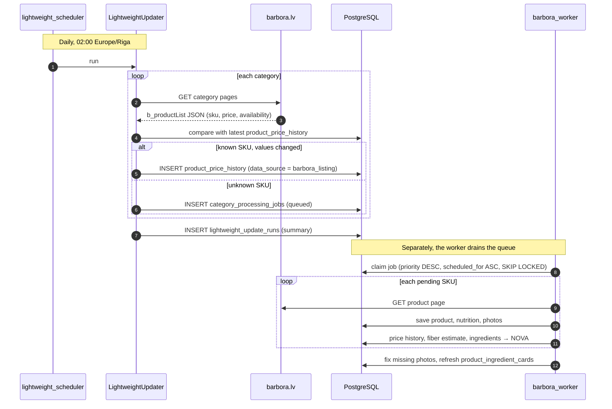
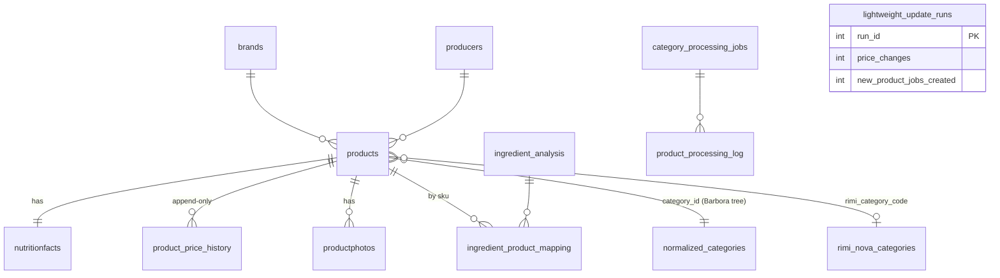
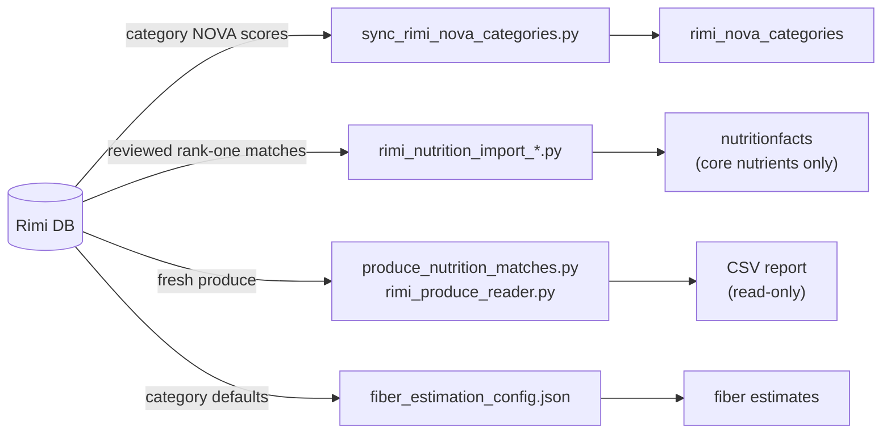
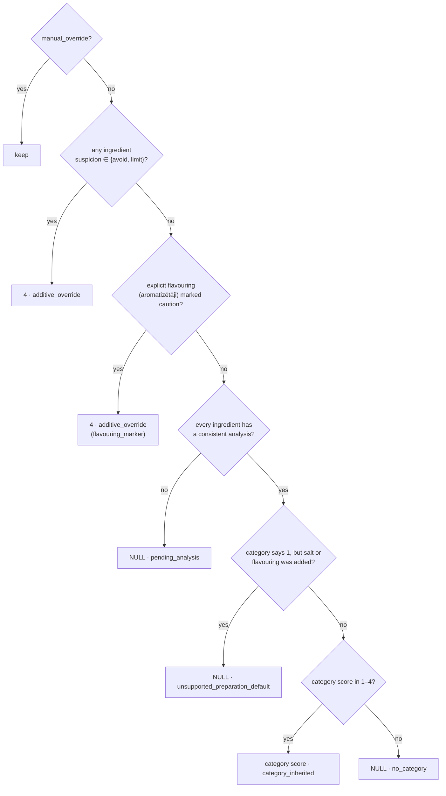

# BarboraScraper-v1 Architecture

BarboraScraper-v1 collects products from [Barbora.lv](https://barbora.lv), the online store of Maxima Latvia, and stores them in PostgreSQL. The [abcde.lv](https://abcde.lv) website reads this database as its Maxima source, through the website's `MAXIMA_DATABASE_URL`.

The repository is a fork of [RimiScraper-v2](https://github.com/yuri-ivanov1972/RimiScraper-v2), and the two share their root commit. A lot of generic code is still shared with the Rimi scraper, sometimes unused: `worker.py`, `core_parser.py`, `batch_processor.py` and others. The Barbora-specific path is described below.

## Components

Barbora pages embed their data as JSON, so the parser decodes JavaScript objects with `json.JSONDecoder().raw_decode` instead of scraping HTML text:

- Category pages carry the product list in `window.b_productList`.
- Product pages carry their data in `window.__remixContext`.

## Two update paths

- **Lightweight path** (daily): reads only listing JSON, roughly 10–50× faster than full scraping. It inserts a price row only when a price field changes beyond a tolerance of €0.01, and it queues jobs for SKUs it hasn't seen before.
- **Full path** (worker): `barbora_worker.py` claims queued jobs and scrapes each product page. It can run once (`--single-run`) or until the queue is empty (`--exit-when-empty`).

`combined_startup.sh` starts the Streamlit UI and the lightweight scheduler. It doesn't start the worker. `ENABLED = False` in `lightweight_scheduler.py`, and the startup script passes `--enable` to override it.

## Data model

The schema is in `barbora_schema.sql`, generated from the live database on 2026-04-27. It closely follows Rimi's schema with these differences:

| Difference | Purpose |
|---|---|
| `products.barbora_url` replaces `rimi_url` | Source link |
| `products.ingredients`, `allergens` and `description` | Raw text stored on the product |
| `products.rimi_category_code` (integer) | Points to a Rimi `normalized_categories.category_id`. The website uses it to place Maxima products in Rimi's category tree. |
| `products.has_confirmed_match` | A Barbora product has been matched to a Rimi product. |
| `products.name_manual_edit` | Keeps a manually edited name from being overwritten by the scraper. |
| `rimi_nova_categories` | Local cache of Rimi category NOVA scores, filled by `sync_rimi_nova_categories.py` |
| `lightweight_update_runs` | History of daily listing-only runs |
| `translation_cache` | Product name translations to English (Gemini, manual or rule-based) |

As in the Rimi scraper, `product_price_history` is append-only, and the current price is the latest row.

## Links to Rimi data

The Rimi database is opened read-only through `RIMI_DATABASE_URL`. Several approved, audited one-time operations copy data from it:

The rules for these operations are described in `docs/rimi-nutrition-import.md` and `docs/rimi-produce-report.md`:

- The source and destination databases must be different.
- Import only from the reviewed manifest.
- Before writing, check the full before-image of each product and nutrition row and lock the target rows.
- Never write fiber or `is_fiber_correct`.
- Never overwrite fields that were set manually.

## Scoring

Nutri-Score and fiber estimation follow the same algorithm as RimiScraper-v2. The formulas are in that repository's `ARCHITECTURE.md` and in `NUTRISCORE_ALGORITHM.md` here. Fiber defaults are looked up by `rimi_category_code`.

### NOVA rules

The Barbora version is stricter than the Rimi version. If the analysis is missing or contradictory, the product's NOVA stays unknown instead of being treated as unprocessed:

`_assign_nova_score` locks the product row with `FOR UPDATE` and re-reads the ingredient mappings before writing. This prevents a race with refresh jobs running at the same time.

## Maintenance tools

Most of the code added since the fork is careful repair tooling. Each tool comes as a *plan → preview → apply* set of modules, with a Streamlit UI and a write-up in `docs/`:

| Tool | Modules | Doc |
|---|---|---|
| Photo maintenance | `photo_maintenance*.py`, `photo_sources.py`, `fix_broken_photos.py` | `docs/photo-maintenance.md`, `docs/barbora-photo-formats.md` |
| Product card refresh | `product_refresh_{plan,source,store,ui}.py` | `docs/product-card-refresh.md` |
| Nutrition reload | `nutrition_reload_{plan,source,store}.py`, `reload_barbora_nutrition.py` | `docs/barbora-nutrition-reload.md` |
| Enrichment availability | `enrichment_availability.py` | `docs/enrichment-availability.md` |
| Poultry recovery and scoring | `poultry_*.py`, `recover_poultry_category.py` | `docs/poultry-*.md` |
| Brand and producer backfill | `backfill_brand_producer.py`, `migrate_brand_producer.py` | `BRAND_PRODUCER_BACKFILL.md` |

## Notes

- `replit.md` is still titled "Maxima Product Scraper" and describes Rimi in several places. `WORKER_USAGE.md` documents the Rimi `worker.py`, not `barbora_worker.py`.
- The Barbora worker's `claim_job` sets `status = 'processing'`. The Rimi worker uses `in_progress` with heartbeat leases. The Barbora worker doesn't reclaim stale jobs.
